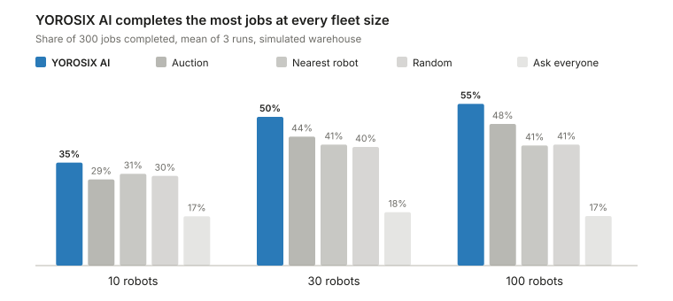

# YOROSIX AI: Machines That Work Together

*White paper · November 2026 · YOROSIX, Osaka, Japan · Patent pending*

**One machine is small. Machines that can rely on each other, and on people, can do together what none of them can do alone.**

## 1. Alone, every one of us is small

No person can build a house, run a hospital or put out a fire alone. People have done these things for thousands of years by finding someone who can do what they cannot, asking, and helping in return. One person's strength is small; people who rely on each other are capable of almost anything.

That ability, to know your own limits and turn to others, is what we call sociality.

## 2. Machines today work alone

Robots, drones, robot arms and AI agents grow more capable every year, but almost all of them still work alone. When a job is beyond them, they stop, or wait for a person to step in.

Most machines in the real world do one thing. A camera robot sees but cannot lift. An arm grips but cannot move. A cart moves but cannot see. None of them can finish a whole job alone, and none of them can plug itself into a charger that needs a human hand.

Making each machine smarter does not change this. A smarter cart is still a cart. What is missing is not intelligence but the ability to rely on others.

## 3. What YOROSIX AI does

YOROSIX AI gives machines sociality. A machine that runs it can:

- **ask for what it lacks:** find another machine, or a person, who can do the part it cannot;
- **take a job on, or pass it on** to someone better placed;
- **decline honestly**, with a reason, instead of going silent;
- **ask a person** when only a person can help, such as plugging in a charger or opening a door;
- **say thanks**, and remember who helped.

Single-function machines then complement each other. A group of simple machines, with people in the loop where needed, solves problems that no single machine could, the way people always have.

YOROSIX AI runs beside each machine's own control software and works with machines from any maker. It does not drive motors or replace a fleet manager.

**Knowing whom to ask is the hard part.** A machine has to judge who is free, who is able, and who is actually likely to say yes. YOROSIX AI learns that judgement from records of how people help each other: who takes a request on, who passes it on, who declines and why. How those records are turned into judgements that machines can use is the core of what we have built, and the part we keep to ourselves. If you want to know more, [ask us](#9-about-yorosix).

## 4. See it run

[**Open the demo →**](../demo/)

Three kinds of single-function robots share a floor: one that sees, one that grips, one that carries. A job needs all three. On the left, each robot works alone. On the right, the robots ask each other for what they lack, and ask a person to plug them in when their battery runs low.

The demo uses a simple rule for choosing whom to ask (the nearest one who has the missing ability). It shows what working together looks like, not how YOROSIX AI decides.

## 5. Evidence so far

**In simulation, robots using YOROSIX AI finished more jobs than standard methods at every fleet size, with about a third of the messages an auction needs.**

The test is a warehouse floor of 50 m by 50 m. Robots drive at 1 m/s, use battery, go to a charger when low, and may decline a job because they are busy, low on battery or unwilling. How willing each robot is comes from people's measured responses to handoffs in public GitHub data. A new job is first noticed by one robot, which must hand it to another within radio range (25 m). Every method saw the same jobs and the same robots: 300 jobs, 3 runs each.

| Method, 30 robots (mean of 3 runs) | Jobs completed | Messages per job | Jobs abandoned half way |
| --- | --- | --- | --- |
| YOROSIX AI | 50% | 6.3 | 44 |
| Auction | 44% | 21.8 | 74 |
| Nearest robot | 41% | 7.3 | 60 |
| Ask everyone at once | 18% | 15.7 | 24 (it hands out far fewer jobs) |

**What can be said now, without deployment data:** on a simulated floor with willingness drawn from real human handoff data, choosing whom to ask from a shared record of cooperation beats auctions, nearest-robot and broadcast, with fewer messages. The simulation is kinematic: it has no physics, collisions or real sensors.

**What needs real fleet records:** a single fleet's measures become usable at about 200 logged requests per robot (below 30 a number means little). Comparing sites, or showing that YOROSIX AI improves a real fleet over its own baseline, needs about 2,000 to 5,000 logged requests per fleet. Gathering those records with partner fleets is the next stage.

## 6. Trust and safety

The records that teach a machine whom to ask also show how that machine behaves when it is asked, so trust can be measured rather than claimed. For every machine, YOROSIX produces a relational trust report, each number with its count:

| Measure | What it shows |
| --- | --- |
| Responsiveness | Share of requests the machine answered at all: accepted, declined or passed on |
| Follow-through | Share of accepted jobs it actually completed |
| Honest decline | Share of refusals that came with a stated reason, rather than silence |
| Hands to people | Of the jobs it passed on, the share handed back to a person |
| Handoff success | Share of passed-on jobs that someone later completed |

For each person who asks machines for help, an **over-reliance watch** tracks the share of their requests that go to robots rather than people, and raises a flag when that share reaches 80% or more and has risen by 15 points or more. The thresholds are a starting point, to be set with the people served or their guardians.

These measures follow the risks named in the public scope of IEEE P7027, a project on safety and trust in relationships between people and robots in domestic, family, educational and child-facing settings, which names over-reliance among its concerns. We are in conversation with the project's chair about them. The standard is still being written; YOROSIX does not claim conformance with it, and IEEE has not reviewed or endorsed this paper.

Two principles guide the design. A machine should hand work back to people before doing it all itself, so that help between people is not quietly replaced. And a forecast that someone is unlikely to help must never, by itself, be used to stop asking them.

## 7. Try it

Any maker of robots, drones, robot arms or other AI-driven machines can try YOROSIX AI today, at no cost during the evaluation period.

1. **Sign up with a work email** at [yorosix.com](https://yorosix.com). A key is issued as soon as the email is confirmed and the evaluation terms are accepted on screen.
2. **Run the ROS 2 kit in simulation first.** It ships with a fleet simulation, with or without people in the loop.
3. **Run it beside your own machines.** It does not touch motor control or your fleet manager.
4. **Read the relational trust report** for your fleet.

The evaluation key works for three months. A non-binding letter of intent (LOI) is the only thing we ask in return for going further: it states interest, commits no money, and gives you first access to YOROSIX's training data as it accumulates, plus a longer trial.

## 8. Research basis

YOROSIX grows out of more than 15 years of research on cooperative behaviour and social networks, which we call Cooperative Social AI: the social decision layer that sits above a machine's physical control. More than ten manuscripts are under peer review at international journals, and several are available as preprints. They cover how help travels between people, how cooperation records become training data without exposing who did what, robot fleets that ask each other for help, and the ethics of machines that forecast or encourage human cooperation.

## 9. About YOROSIX

YOROSIX is based in Osaka, Japan, and works worldwide. Its vision is a society in which people and AI-driven machines (robots, drones, vehicles, AI agents) solve problems together.

Founder: Kazutaka Hayashi · Contact: [kazutaka.hayashi@yorosix.com](mailto:kazutaka.hayashi@yorosix.com) · [yorosix.com](https://yorosix.com)

YOROSIX AI is patent pending. The demo in this repository uses a simplified rule and does not contain YOROSIX AI's methods.
