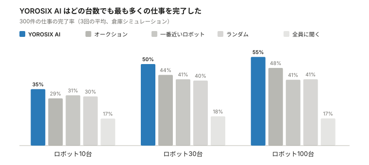

# YOROSIX AI：力を合わせる機械

*ホワイトペーパー · 2026年11月 · YOROSIX（大阪） · 特許出願中*

**1台の機械の力は小さい。互いに、そして人に頼り合える機械なら、1台ではできないことを一緒に成し遂げられる。**

## 1. ひとりの力は小さい

家を建てることも、病院を回すことも、火事を消すことも、ひとりではできません。人は何千年もの間、自分にできないことができる相手を見つけ、頼み、お返しに手を貸すことで、それを成し遂げてきました。ひとりの力は小さくても、頼り合う人の集まりにできないことはほとんどありません。

自分の限界を知り、他に頼れる力。私たちはそれを「社会性」と呼んでいます。

## 2. 今の機械は、ひとりで動いている

ロボット、ドローン、ロボットアーム、AIエージェントは年々賢くなっています。それでも、ほとんどは今もひとりで動いています。自分の手に余る仕事に当たると、止まるか、人が入るのを待つしかありません。

現場の機械の多くは、一つのことしかできません。台車は動けてもつかめない。アームはつかめても動けない。ドアを開ける機械は、それ以外のことができない。どれも1台では仕事を最後までやり切れず、人の手がいる充電器に自分でつなぐこともできません。

1台ずつを賢くしても、これは変わりません。賢くなった台車も台車のままです。足りないのは賢さではなく、他に頼る力です。

## 3. YOROSIX AI がすること

YOROSIX AI は機械に社会性を与えます。YOROSIX AI を入れた機械は、次のことができます。

- **自分にないものを頼む：** 自分にできない部分ができる、別の機械や人を見つける
- **引き受ける、または回す：** もっと向いている相手がいれば、そちらに回す
- **正直に断る：** 黙り込まず、理由を添えて断る
- **人に頼む：** 充電器につなぐ、ドアを開けるなど、人にしかできないときは人に頼む
- **お礼を言う：** 誰が助けてくれたかを覚えておく

すると、一つのことしかできない機械どうしが補い合います。単純な機械の集まりが、必要なところでは人の力も借りて、1台ではできない課題を解決します。人がずっとそうしてきたのと同じです。

YOROSIX AI は各機械の制御ソフトの横で動き、どのメーカーの機械でも使えます。モーターを動かしたり、フリート管理を置き換えたりはしません。

**難しいのは、誰に頼めばいいかを知ることです。** 機械は、誰が空いていて、誰ができて、誰が本当に引き受けてくれそうかを判断しなければなりません。YOROSIX AI はその判断を、人が助け合った記録から学びます。誰が頼みを引き受け、誰が他に回し、誰がなぜ断ったか。その記録を機械が使える判断に変える方法こそが私たちの技術の核心で、ここでは明かしません。詳しく知りたい方は、[お問い合わせください](#9-yorosixについて)。

## 4. 動くところを見る

[**デモを開く →**](../demo/?lang=ja)

3種類の単機能ロボットが同じ床で働きます。ドアを開けるだけのロボット、つかむだけのロボット、運ぶだけのロボットです。どの仕事も閉まったドアの向こうにあり、3つの力が全部いります。左側では、どのロボットもひとりで働きます。右側では、ロボットどうしが足りないものを頼み合い、電池が減ったら人に充電を頼みます。

デモの頼む相手の選び方は、単純な決まり（その力を持っている一番近い相手）です。力を合わせるとどうなるかを見せるもので、YOROSIX AI の判断の仕方は入っていません。

## 5. これまでの証拠

**シミュレーションでは、YOROSIX AI を使うロボットが、どの台数でも標準的な方法より多くの仕事を完了しました。やりとりはオークション方式の約3分の1で済みました。**

試験の場は50m四方の倉庫の床です。ロボットは秒速1mで走り、電池を使い、残りが少なくなると充電器に向かいます。忙しい、電池が少ない、気が進まない、といった理由で仕事を断ることもあります。各ロボットの引き受けやすさは、公開されているGitHubデータで測った、人が仕事を引き継がれたときの反応から作っています。新しい仕事はまず1台のロボットが気づき、無線の届く範囲（25m）にいる別のロボットに渡さなければなりません。どの方法も同じ仕事、同じロボットで試しました。仕事は300件で、それぞれ3回ずつ実行しています。

| 方法（ロボット30台、3回の平均） | 完了した仕事 | 1件あたりのやりとり | 途中で投げ出した仕事 |
| --- | --- | --- | --- |
| YOROSIX AI | 50% | 6.3 | 44 |
| オークション | 44% | 21.8 | 74 |
| 一番近いロボット | 41% | 7.3 | 60 |
| 全員に一斉に聞く | 18% | 15.7 | 24（割り振る仕事自体がずっと少ない） |

**今、運用データなしで言えること：** 実際の人の引き継ぎデータから引き受けやすさを作った模擬の床では、協力の共有記録から誰に頼むかを選ぶ方が、オークション、一番近いロボット、一斉送信より成績がよく、やりとりも少なくて済みます。シミュレーションは動きだけを扱うもので、物理演算、衝突、実際のセンサーは入っていません。

**実際のフリートの記録が必要なこと：** 1つのフリートの指標は、ロボット1台あたり約200件の依頼の記録で使えるようになります（30件未満ではほとんど意味がありません）。現場どうしの比較や、YOROSIX AI で実際のフリートが元より良くなることを示すには、フリートあたり約2,000～5,000件の記録が必要です。その記録をパートナーのフリートと一緒に集めるのが、次の段階です。

## 6. 信頼と安全

機械に誰に頼むかを教える記録は、その機械が頼まれたときにどうふるまったかも示します。だから信頼は、主張するものではなく測るものになります。YOROSIX は機械ごとに「関係の信頼レポート」を作り、どの数字にも件数を添えます。

| 指標 | 示すこと |
| --- | --- |
| 応答性 | 頼まれたうち、何らかの答え（引き受ける・断る・他に回す）を返した割合 |
| やり遂げる力 | 引き受けた仕事のうち、実際に完了した割合 |
| 正直な断り | 断ったうち、黙っていたのではなく理由を添えた割合 |
| 人に戻す | 他に回した仕事のうち、人に戻した割合 |
| 引き継ぎの成功 | 他に回した仕事のうち、あとで誰かが完了した割合 |

機械に助けを頼む人ごとに、**頼りすぎの見守り**も行います。その人の頼みごとのうち、人ではなくロボットに行った割合を追い、80%以上になり、かつ15ポイント以上上がったときに知らせます。この基準は出発点で、使う人（子どもなら保護者）と一緒に決めるものです。

これらの指標は、IEEE P7027の公開された範囲に挙げられたリスクに沿っています。P7027は、家庭・家族・教育・子ども向けの場での人とロボットの関係の安全と信頼を扱うプロジェクトで、頼りすぎを懸念の一つに挙げています。私たちはこの指標についてプロジェクトの議長と対話しています。標準はまだ策定中です。YOROSIX は適合を主張しておらず、IEEE がこの文書を確認・承認したこともありません。

設計には2つの原則があります。機械は自分で全部引き受ける前に、仕事を人に戻すこと。そうしないと、人どうしの助け合いがいつの間にか置き換わってしまいます。そして、「この人は助けてくれなさそうだ」という予測だけを理由に、その人に頼むのをやめてはいけないこと。

## 7. 試し方

ロボット、ドローン、ロボットアームなど、AIで動く機械のメーカーならどこでも、今日から YOROSIX AI を試せます。評価期間中は費用はかかりません。

1. **仕事用メールで登録します**（[yorosix.com](https://yorosix.com)）。メールの確認と、画面上での評価条件への同意が済むと、すぐにキーが発行されます。
2. **ROS 2キットをまずシミュレーションで動かします。** フリートのシミュレーションが付いていて、人を加えた形でも試せます。
3. **自社の機械の横で動かします。** モーター制御やフリート管理には触れません。
4. **自社のフリートの関係の信頼レポートを読みます。**

評価用のキーは3か月使えます。その先に進むためにお願いするのは、法的拘束力のない意向表明書（LOI）だけです。LOIは関心を示すもので、お金の約束は含みません。LOIをくださった方には、YOROSIX の教師データをたまり次第優先してご提供し、試用期間も延長します。

## 8. 研究の裏付け

YOROSIX は、協力行動と社会ネットワークに関する15年以上の研究から生まれました。私たちはこれを「Cooperative Social AI」と呼んでいます。機械の物理的な制御の上にある、社会的な判断の層です。10本を超える論文が国際学術誌で査読中で、いくつかはプレプリントとして公開しています。扱っているのは、助けが人から人へどう伝わるか、誰が何をしたかを明かさずに協力の記録を教師データに変える方法、互いに助けを頼み合うロボットのフリート、人の協力を予測したりうながしたりする機械の倫理です。

## 9. YOROSIXについて

YOROSIX は大阪を拠点に、世界を相手に活動しています。目指すのは、人とAIで動く機械（ロボット、ドローン、車、AIエージェント）が一緒に問題を解決する社会です。

創業者：林 和孝 · 連絡先：[kazutaka.hayashi@yorosix.com](mailto:kazutaka.hayashi@yorosix.com) · [yorosix.com](https://yorosix.com)

YOROSIX AI は特許出願中です。このリポジトリのデモは単純化した決まりを使っており、YOROSIX AI の方法は含んでいません。
